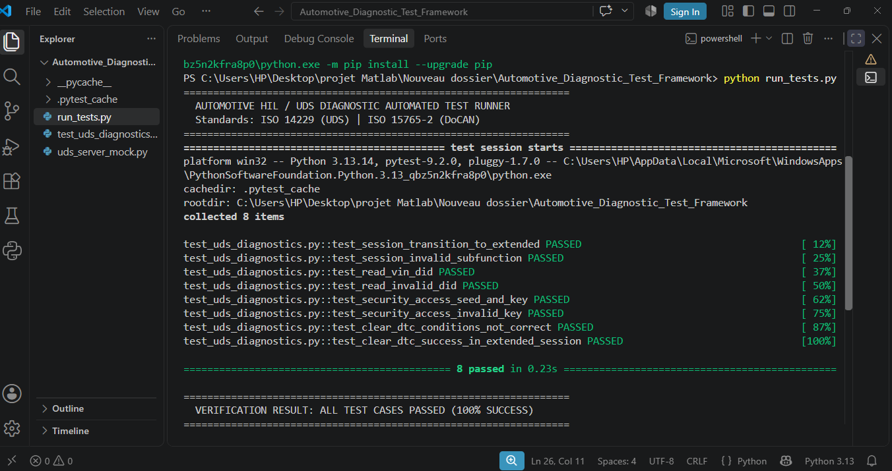

# Automotive Diagnostic & HIL Automated Testing Framework (ISO 14229 / UDS)


An automated verification and validation (V&V) test framework for Automotive Electronic Control Units (ECUs). Designed to automate Hardware-in-the-Loop (HIL) diagnostic test sequences across Unified Diagnostic Services (UDS over CAN/DoCAN).

---

## 📷 Test Execution & Automated Verification Dashboard

The framework runs deterministic functional and negative test suites with zero manual intervention:



---

## 🎯 Test Suite Coverage & Verification Scope

The test framework evaluates positive behaviors and Negative Response Codes (NRC) across safety-critical diagnostic services:

| Service ID (SID) | Service Description | Verified Sub-functions / Conditions | Expected Behavior / NRC |
| :--- | :--- | :--- | :--- |
| **0x10** | Diagnostic Session Control | Default (0x01), Extended (0x03) | `0x50` Positive Ack / `0x12` SubFunctionNotSupported |
| **0x22** | Read Data By Identifier | VIN (`0xF190`), Telemetry (`0x2001`, `0x2002`) | Positive Data Payload / `0x31` RequestOutOfRange |
| **0x27** | Security Access | Seed Request (`0x01`), Key Validation (`0x02`) | Dynamic Seed-Key Auth / `0x35` InvalidKey |
| **0x14** | Clear Diagnostic Info | Extended Session Pre-condition Check | `0x54` Clear Success / `0x22` ConditionsNotCorrect |

---

## 📁 Repository Structure

```text
├── uds_server_mock.py        # Simulated ECU Diagnostic Server handling UDS requests
├── test_uds_diagnostics.py   # Pytest automated test scenarios (Positive & Negative paths)
├── run_tests.py              # Test harness runner and execution reporting summary
└── diagnostic_test_results.png # Automated execution screenshot